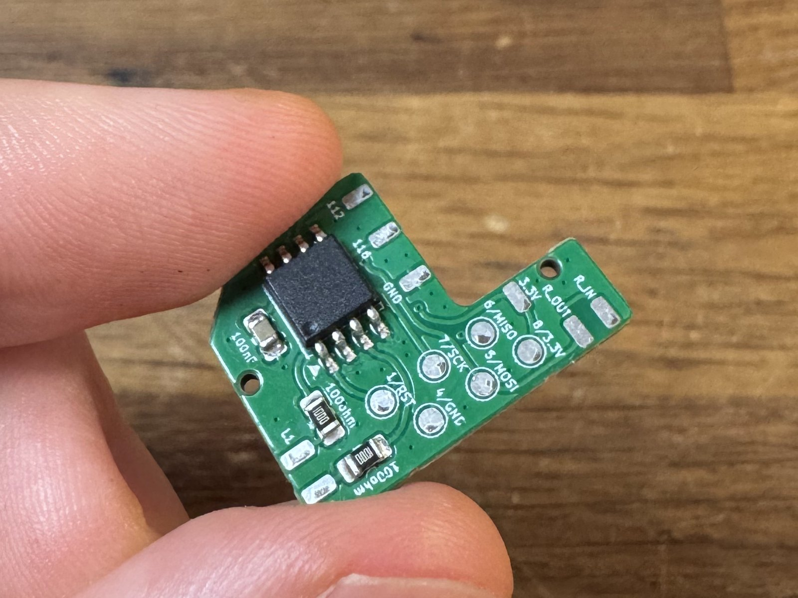
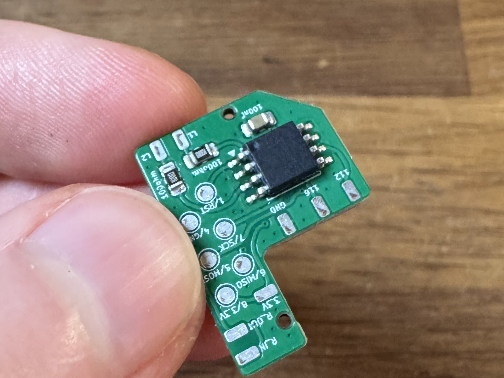
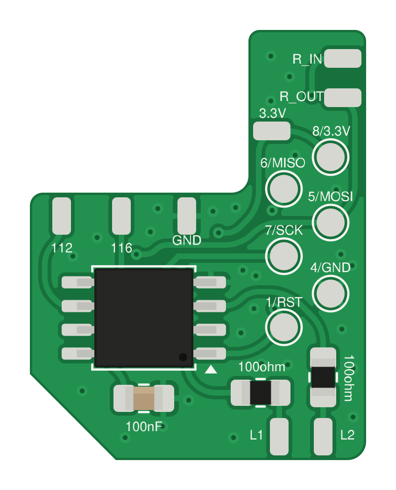
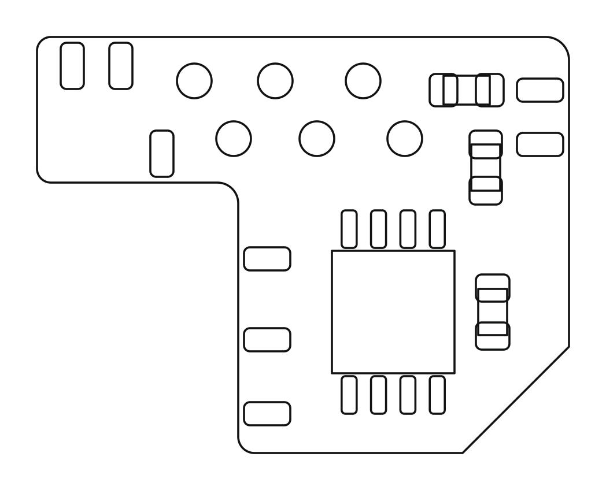

# N64 Switchless Overclock 🎮

Salut les bidouilleurs et les makers ! Voici le petit PCB d’overclock que j’ai réalisé pour ma Nintendo 64 custom. Il utilise un **ATtiny45** et le firmware **ManCloud**, avec le bouton RESET pour sélectionner le mode et une LED bicolore pour le repérer.

Je partage les sources KiCad, les fichiers de fabrication, les photos et surtout la méthode de flash avec un **ESP32 utilisé comme programmateur ISP lent**. C’est ce qui nous a permis de contourner les soucis rencontrés avec l’adaptateur USBasp après le changement d’horloge de l’ATtiny.

## À quoi sert cette carte ?

L’**overclock**, c’est faire fonctionner le processeur de la console plus vite que son réglage habituel. Cela peut améliorer la fluidité de certains jeux, mais le résultat varie d’un jeu et d’une console à l’autre.

Le mot **switchless** signifie « sans interrupteur supplémentaire » : on utilise le bouton RESET déjà présent sur la N64 pour choisir le mode. La petite puce **ATtiny45** lit ce bouton et commande les signaux de sélection du processeur. Le programme qui lui dit quoi faire s’appelle le **firmware** ; ici, c’est celui de ManCloud.

### Comment changer de mode ?

1. Un appui court sert à réinitialiser la console, comme d’habitude.
2. Un appui long permet de changer le mode sélectionné, indiqué par la LED à deux couleurs.
3. Il faut ensuite **éteindre puis rallumer la console** pour appliquer le nouveau réglage.

Les nombres ×1,5 et ×2 sont des multiplicateurs de l’horloge de base. **×2 ne veut pas dire que la console devient deux fois plus rapide que d’origine** : son réglage habituel est déjà ×1,5.

### La version du programme utilisée

Le firmware choisi est la variante **ATtiny45, multiplicateur maximal ×2, LED à cathode commune**, compilée avec `make tiny45_CC`. Son fichier s’appelle `n64_overclock_t45_2_0X_CC.hex`. Un appui court conserve la fonction RESET ; un appui long fait défiler les modes. Après sélection, il faut **éteindre puis rallumer la console** pour appliquer le multiplicateur, comme l’indique [ManCloud](https://github.com/ManCloud/n64_overclock).

Le mode standard est ×1,5 et l’autre mode est ×2. Les performances et la stabilité dépendent de la console, de son refroidissement et du jeu. La couleur de la LED indique un choix ; pour confirmer la vitesse réellement obtenue, il faut une mesure ou un test de performances (un « benchmark »).

## La carte

## Programmer la carte : commencez ici

**Flasher** signifie copier un programme dans une puce. Il y a ici deux programmes différents :

| Programme | Où le charger ? | À quoi sert-il ? |
|---|---|---|
| Le sketch `ESP32_AVR_ISP.ino` | Dans l’ESP32, avec Arduino IDE | Transformer l’ESP32 en outil pour programmer l’ATtiny |
| Le firmware ManCloud au format `.hex` | Dans l’ATtiny45 de la carte overclock | Faire fonctionner le mod une fois installé dans la N64 |

Pendant la programmation, le chemin est : **ordinateur → câble USB → ESP32 → six fils → carte overclock**. L’ESP32 sert seulement à préparer la carte : il ne reste pas dans la console.

👉 **[Guide complet : Arduino IDE, ESP32, câblage, AVRDUDE et fusibles](docs/FLASH-ESP32.md)**

Le **sketch** (programme Arduino) [pour l’ESP32](programming/ESP32_AVR_ISP/ESP32_AVR_ISP.ino) a été retrouvé dans le fichier utilisé pour le projet. Il utilise **STK500v1**, le langage attendu par l’outil de transfert, à **19 200 bauds**. Il envoie les données à l’ATtiny avec une horloge lente d’environ **10 kHz**, adaptée à son réglage. Ces nombres sont déjà renseignés dans le guide et le sketch. Le guide distingue bien le firmware à charger dans l’ATtiny du sketch à charger dans l’ESP32.

**La dernière étape change le rôle d’une patte de l’ATtiny pour que le bouton RESET puisse servir au mod. Ensuite, on ne peut plus reprogrammer la puce avec ce même branchement ESP32.** C’est le réglage `HFUSE = 0x5F` : il faut le faire uniquement à la fin, après toutes les vérifications. Le guide explique cet ordre et la méthode particulière nécessaire pour revenir en arrière.

## Repères du PCB

Les **pastilles** sont les petites surfaces métalliques où souder les fils. Les inscriptions blanches sur la carte sont la **sérigraphie**. Le tableau ci-dessous indique où vont ces pastilles dans les fichiers KiCad fournis.

- **GND** : la masse, le point commun de référence électrique du montage.
- **3,3 V** : l’alimentation de la carte pendant la programmation.
- **MOSI, MISO et SCK** : les trois fils utilisés pour échanger les données de programmation.
- **RST / RESET** : le fil qui permet au programmateur de prendre le contrôle de la puce.
- **Broche** : une patte physique du composant ; **PB0, PB1…** sont les noms que lui donne le fabricant.

Pour relier l’ESP32, utilisez le [tableau de câblage du guide](docs/FLASH-ESP32.md#3-câbler-esp32--pcb-overclock), qui donne aussi les numéros des GPIO. Ne vous servez pas du tableau ci-dessous pour deviner ces numéros.

| Repère du PCB | Connexion ATtiny45 | Rôle |
|---|---|---|
| `1/RST` | Broche 1, PB5 | RESET pendant la programmation |
| `5/MOSI` | Broche 5, PB0 | MOSI pendant la programmation |
| `6/MISO` | Broche 6, PB1 | MISO pendant la programmation |
| `7/SCK` | Broche 7, PB2 | SCK pendant la programmation |
| `4/GND` | Broche 4 | Masse |
| `TP6`, sérigraphie `8/3.3V` | Broche 8 | Alimentation 3,3 V |
| J2, `RIN` / `R_IN` | Broche 1 | Entrée côté bouton RESET |
| J3, `ROUT` / `R_OUT` | Broche 5 | Sortie RESET côté console |
| J4, `112` | Broche 6 | Raccordement CPU 112 |
| J5, `116` | Broche 7 | Raccordement CPU 116 |
| J7, `L1` / `LED_R` | Broche 2 via R2, 100 Ω | Première couleur de LED |
| J8, `L2` / `LED_Y` | Broche 3 via R1, 100 Ω | Deuxième couleur de LED |

Une LED bicolore contient deux couleurs et peut avoir une patte commune. La variante **CC** signifie « cathode commune » : cette patte commune doit être reliée au GND. Vérifiez le type de votre LED avant de choisir le firmware. Les noms `LED_R` et `LED_Y` ne déterminent pas la couleur de la LED réellement montée. Sur mon montage, L1 était vert et L2 rouge.

Pour installer le RESET, il faut distinguer les côtés bouton et PIF : **RIN et ROUT ne doivent pas simplement être raccordés à deux points d’une même piste restée continue**. Les anciens échanges identifiaient ROUT vers le PIF-NUS 27. La coupure ou l’isolation exacte dépend de la carte mère : se référer aux photos d’installation adaptées à sa révision avant de modifier les pistes. Voir les [références et vérifications](docs/REFERENCES.md).

## Fabriquer la carte ou modifier le projet

Pour récupérer le projet, cliquez sur **Code → Download ZIP** en haut du dépôt, puis décompressez le fichier sur votre ordinateur.

- Pour **faire fabriquer le circuit imprimé**, le fabricant utilise les fichiers **Gerber** et de perçage contenus dans `production/N64_overclock.zip`.
- Pour **faire monter les composants**, il utilise aussi la **BOM** (liste des composants) et le fichier **positions** (endroit et sens de chaque composant).
- Pour **modifier la carte**, ouvrez le fichier `.kicad_pro` du dossier `hardware` avec KiCad, le logiciel de conception électronique.

La programmation de l’ATtiny et la soudure dans la console sont encore à faire après la fabrication. Les photos de ce dépôt montrent le petit PCB assemblé ; elles ne montrent pas tous les points de soudure d’une installation dans la N64. Avant de modifier la console, il faut un repérage adapté à la version de sa carte mère.

### Où trouver chaque fichier ?

| Dossier ou fichier | Contenu |
|---|---|
| `hardware/` | Projet, schéma et PCB KiCad originaux |
| `production/N64_overclock.zip` | Gerbers et perçages fournis |
| `production/bom.csv` | Liste des composants ; références catalogue LCSC à compléter |
| `production/positions.csv` | Positions originales de placement |
| `programming/ESP32_AVR_ISP/` | Sketch du programmateur ESP32 pour Arduino IDE |
| `docs/FLASH-ESP32.md` | Procédure de flash et dépannage |
| `docs/REFERENCES.md` | Provenance, sources et limites des vérifications |
| `docs/images/` | Schéma, rendu, tracé et photos |
| `SOURCE-SHA256.txt` | Codes de contrôle pour vérifier que les fichiers sont restés identiques |

Les seuls composants à assembler sont **U1 (ATtiny45 SOIC-8), C1 (100 nF) et R1/R2 (100 Ω)**. Les six points de test et J1 à J8 sont des pastilles, pas des pièces à acheter. Si le fabricant les indique comme non assemblés, c’est attendu uniquement pour ces repères. Les références **LCSC** sont les numéros du catalogue de composants utilisé pour l’assemblage JLCPCB. Elles sont vides dans cette BOM : il faut encore choisir les bonnes pièces avant de commander une carte assemblée. Cette BOM n’est donc pas une commande prête à valider sans vérification.

## Crédits

- [ManCloud — n64_overclock](https://github.com/ManCloud/n64_overclock) : firmware AVR. Le source porte une licence **GPL-2.0-only**.
- [borti4938 — N64 Switchless Overclock](https://github.com/borti4938/N64_Switchless_Overclock) : projet à l’origine du port AVR.
- [Consoles Unleashed — Nintendo 64 Switchless Overclock PCB](https://github.com/consolesunleashed/nintendo-64-switchless-overclock-pcb) : référence de PCB citée dans les échanges de conception.

Le firmware ManCloud est récupéré depuis son dépôt d’origine, à une révision précise indiquée dans le guide. Aucune nouvelle licence globale n’est imposée aux fichiers matériels ou au sketch récupéré ; leur provenance et leurs droits restent à distinguer. Projet indépendant, sans affiliation avec Nintendo.
