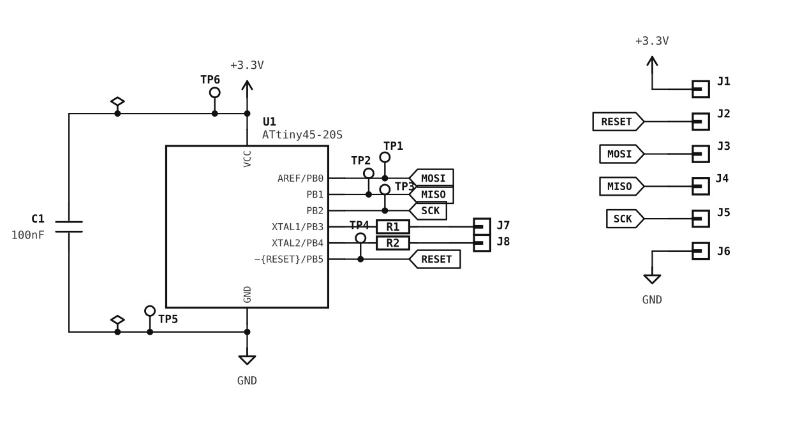

# N64 Switchless Overclock 🎮

Salut les bidouilleurs et les makers ! Voici le petit PCB d’overclock que j’ai réalisé pour ma Nintendo 64 custom. Il utilise un **ATtiny45** et le firmware **ManCloud**, avec le bouton RESET pour sélectionner le mode et une LED bicolore pour le repérer.

Je partage les sources KiCad, les fichiers de fabrication, les photos et surtout la méthode de flash avec un **ESP32 utilisé comme programmateur ISP lent**. C’est ce qui nous a permis de contourner les soucis rencontrés avec l’adaptateur USBasp après le changement d’horloge de l’ATtiny.

## Le principe

Le firmware choisi est la variante **ATtiny45, multiplicateur maximal ×2, LED à cathode commune**, compilée avec `make tiny45_CC`. Son fichier s’appelle `n64_overclock_t45_2_0X_CC.hex`. Un appui court conserve la fonction RESET ; un appui long fait défiler les modes. Après sélection, il faut **éteindre puis rallumer la console** pour appliquer le multiplicateur, comme l’indique [ManCloud](https://github.com/ManCloud/n64_overclock).

Le mode standard est ×1,5 et l’autre mode est ×2. Les performances et la stabilité dépendent de la console, de son refroidissement et du jeu. Les états de sélection seuls ne remplacent pas une mesure ou un benchmark.

## La carte

## Pour flasher : commencez ici

👉 **[Guide complet : Arduino IDE, ESP32, câblage, AVRDUDE et fusibles](docs/FLASH-ESP32.md)**

Le [sketch ESP32](programming/ESP32_AVR_ISP/ESP32_AVR_ISP.ino) a été retrouvé dans le fichier utilisé pour le projet. Il parle STK500v1 à **19 200 bauds**, avec un SPI logiciel d’environ **10 kHz**. Le guide distingue bien le firmware à charger dans l’ATtiny du sketch à charger dans l’ESP32.

**Point essentiel : écrire HFUSE = `0x5F` désactive RESET et ferme ensuite l’accès ISP classique. Cette opération vient en dernier, après l’écriture et la vérification du firmware et de LFUSE.** Un ESP32 ISP n’est pas un programmateur haute tension.

## Repères du PCB

Ces correspondances viennent des connexions des fichiers KiCad fournis :

| Repère du PCB | Connexion ATtiny45 | Rôle |
|---|---|---|
| `1/RST` | Broche 1, PB5 | RESET pendant la programmation |
| `5/MOSI` | Broche 5, PB0 | MOSI pendant la programmation |
| `6/MISO` | Broche 6, PB1 | MISO pendant la programmation |
| `7/SCK` | Broche 7, PB2 | SCK pendant la programmation |
| `4/GND` | Broche 4 | Masse |
| `TP6`, sérigraphie `8/3.3V` | Broche 8 | Alimentation 3,3 V |
| J2, `RIN` / `R_IN` | Broche 1 | Entrée côté bouton RESET |
| J3, `ROUT` / `R_OUT` | Broche 5 | Sortie RESET côté console |
| J4, `112` | Broche 6 | Raccordement CPU 112 |
| J5, `116` | Broche 7 | Raccordement CPU 116 |
| J7, `L1` / `LED_R` | Broche 2 via R2, 100 Ω | Première couleur de LED |
| J8, `L2` / `LED_Y` | Broche 3 via R1, 100 Ω | Deuxième couleur de LED |

Avec la variante **CC**, la patte commune de la LED va au GND. Les noms `LED_R` et `LED_Y` ne déterminent pas la couleur de la LED réellement montée. Sur mon montage, L1 était vert et L2 rouge.

Pour installer le RESET, il faut distinguer les côtés bouton et PIF : **RIN et ROUT ne doivent pas simplement être raccordés à deux points d’une même piste restée continue**. Les anciens échanges identifiaient ROUT vers le PIF-NUS 27. La coupure ou l’isolation exacte dépend de la carte mère : se référer aux photos d’installation adaptées à sa révision avant de modifier les pistes. Voir les [références et vérifications](docs/REFERENCES.md).

## Les fichiers

| Dossier ou fichier | Contenu |
|---|---|
| `hardware/` | Projet, schéma et PCB KiCad originaux |
| `production/N64_overclock.zip` | Gerbers et perçages fournis |
| `production/bom.csv` | BOM originale, références LCSC non renseignées |
| `production/positions.csv` | Positions originales de placement |
| `programming/ESP32_AVR_ISP/` | Sketch du programmateur ESP32 pour Arduino IDE |
| `docs/FLASH-ESP32.md` | Procédure de flash et dépannage |
| `docs/REFERENCES.md` | Provenance, sources et limites des vérifications |
| `docs/images/` | Schéma, rendu, tracé et photos |
| `SOURCE-SHA256.txt` | Empreintes des fichiers sources et du sketch récupéré |

Les seuls composants à assembler sont **U1 (ATtiny45 SOIC-8), C1 (100 nF) et R1/R2 (100 Ω)**. Les six points de test et J1 à J8 sont des pastilles, pas des pièces à acheter. Si le fabricant les indique comme non assemblés, c’est attendu uniquement pour ces repères. Les références LCSC des vrais composants restent à compléter avant une commande assemblée.

## Crédits

- [ManCloud — n64_overclock](https://github.com/ManCloud/n64_overclock) : firmware AVR. Le source porte une licence **GPL-2.0-only**.
- [borti4938 — N64 Switchless Overclock](https://github.com/borti4938/N64_Switchless_Overclock) : projet à l’origine du port AVR.
- [Consoles Unleashed — Nintendo 64 Switchless Overclock PCB](https://github.com/consolesunleashed/nintendo-64-switchless-overclock-pcb) : référence de PCB citée dans les échanges de conception.

Le firmware ManCloud est récupéré depuis son dépôt d’origine, à une révision précise indiquée dans le guide. Aucune nouvelle licence globale n’est imposée aux fichiers matériels ou au sketch récupéré ; leur provenance et leurs droits restent à distinguer. Projet indépendant, sans affiliation avec Nintendo.
